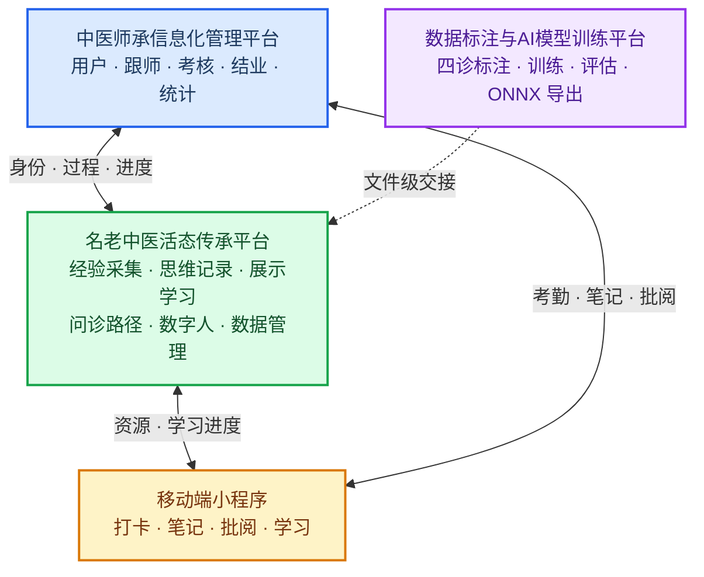

# 名老中医活态传承数智平台
## ——功能架构、核心技术与发展构想（调研与方案展示文档）

| 项目 | 内容 |
| --- | --- |
| 文档类型 | 调研 + 构思 + 方案展示（对齐厦门市中医院《名老中医活态传承平台项目技术解决方案》V1.0） |
| 版本 | v1.2（对齐招标技术方案：业务范围 + 落地要素） |
| 日期 | 2026-10-01 |
| 适用范围 | 名老中医活态传承平台项目（师承管理、活态传承、小程序、数据标注训练四套软件 + 数字人） |
| 关系说明 | 本文为**方案展示文档**，在厦门市中医院招标技术方案（V1.0）的业务范围与验收口径之上，回答"平台做成后长什么样、靠什么技术、创新在哪"；与《需求规格说明书-v3.0-讨论稿》互补——后者管"怎么验收、边界在哪"，本文管"愿景、创新与落地" |

---

## 一、项目概述与建设范围

### 1.1 项目定位

本项目对标**厦门市中医院《名老中医活态传承平台项目技术解决方案》**（V1.0，2026-09）所定义的"名老中医活态传承平台项目"：建设单位为厦门市中医院，建设模式为自主建设、新建，建设周期 12 个月，软件免费质保不少于 3 年。平台部署于医院内网，遵循信创与等保要求，旨在以数字化手段破解名老中医经验"留存难、传承难、复用难"的行业痛点。

### 1.2 建设背景：名老中医传承的时代难题

中医药的活水源头，是名老中医几十年的临床经验与辨证智慧。但这一最宝贵的资源正面临三重断层：

1. **"人在技在，人亡技亡"**。一位名老中医数十年积累的辨证直觉、用药分寸、面对疑难病时的临证决断，大多存在于其头脑与师徒口传心授之间，难以规模化沉淀，随着老中医年事渐高而面临流失风险。
2. **"能看病"与"会讲理"的分离**。传统跟诊只能看到"结果"（开了什么方），很难完整复现"过程"（为什么这么辨证、为什么这么配伍、内心如何权衡取舍）。年轻医生"知其然"而难"知其所以然"。
3. **"口传"难以"复制"**。一位名老中医一次只能带有限的弟子，地域、时间、精力都构成传承瓶颈；而其本人精力有限，无法回应海量学员的求教。

**我们的回答**：建设"名老中医活态传承数智平台"，用数字人技术把名老中医的**形态、神态、知识、心智、问诊能力与内心推断过程**完整数字化，让名老中医的"活态"——不止是知识文本，更是**思维过程与人格气质**——可以被记录、被复现、被学习、被追问，实现"人走技留、技可复制、思可追溯"。

### 1.3 建设目标

本期建设实现六个可验收目标（G1—G6）：

| 编号 | 目标 | 验收要点 |
| --- | --- | --- |
| G1 | 师承全周期在线管理 | 用户、跟师、考核、结业、统计主路径贯通 |
| G2 | 名医经验可采集、可展示、可学习 | 病案、音视频、四诊和思维记录可入库检索，学员可学习并提交心得 |
| G3 | 移动端过程不断档 | 打卡、笔记、批阅、学习与计算机端数据一致 |
| G4 | 数字人可教学调用 | 不少于 3 名核心名医数字人可完成辨证模拟和问答，医案来源可追溯 |
| G5 | 问诊路径可提示 | 根据已采集信息提示完整度及下一步追问方向 |
| G6 | 标注与训练工具可用 | 独立完成数据集管理、标注、训练监控、评估和 ONNX 导出 |

### 1.4 建设范围：四套定制软件 + 两套成品采购

| 序号 | 系统名称 | 建设方式 | 作用 |
| --- | --- | --- | --- |
| 1 | 中医师承信息化管理平台 | 定制开发 | 师承全周期管理：用户、跟师、考核、结业、统计（主系统） |
| 2 | 名老中医活态传承平台 | 定制开发 | 经验采集、思维记录、展示学习、问诊路径、数字人、数据管理 |
| 3 | 移动端小程序 | 定制开发 | 现场打卡、笔记录入、移动批阅、消息通知、经验学习 |
| 6 | 数据标注与AI模型训练平台 | 定制开发 | 独立工具，用于四诊影像标注、训练、评估、ONNX 导出 |
| 4 | 传承服务工作站 | 成品采购 | 不纳入本期模块设计与软件验收主体 |
| 5 | 中医适宜技术智慧实训教学系统 | 成品采购 | 成品及配套硬件采购，不纳入本期模块设计 |

### 1.5 建设原则

1. **医院主导、数据自主**：平台部署于医院环境，名老中医经验与模型资产由医院管理，防止核心诊疗经验因外部平台依赖而流失或泄露。
2. **统一身份、分级授权**：导师、学员、管理人员使用同一身份源，计算机端与移动端共用账号权限，按角色和数据范围访问。
3. **业务连续优先**：智能问答、问诊模型和数字人推理故障时，打卡、笔记、批阅、资源点播、考核和结业须保持可用。
4. **中医业务与模型训练解耦**：日常师承管理不依赖训练任务完成；训练工具以文件方式交接成果。
5. **安全合规**：落实等保、个人信息保护、密码应用和信创要求，关键操作可审计。

---

## 二、国内外现状调研：别人做到了哪一步

### 2.1 已落地代表案例（分四类对标）

近年来，"名老中医数字人"已从概念走向落地，出现了一批有代表性的产品与方案。按定位可分为四类：

**（一）教学与文化科普类数字人**

| 案例 / 机构 | 数字人形态 | 核心能力 | 技术路线 | 主要局限（我们可超越处） |
| --- | --- | --- | --- | --- |
| **"仲景3D数字人"+"i中医"智能体**（河南中医药大学，2026-08 上岗） | 3D 交互数字人（历史人物形象：头着蓝色巾帻、面容清癯、眉须舒展） | 讲授《伤寒杂病论》、授课答疑、按学生差异提供个性化学习方案（"千人一面"→"因材施教"）；"i中医"24 小时随问随答 | "数智仲景"基座大模型（开源大模型+垂直领域优化）；集成数字人建模、语音克隆、情感表达、唇音同步、动作生成、实时渲染；对《伤寒论》398 条条文逻辑拆解；与"仲景智能辨证系统"互通，实现问诊文本/语音与形象、动作、表情联动 | 以**历史人物**为原型，非"真实名老中医本人"复现；定位**教学**，临床辨证/问诊/内心推断过程的深度展示仍在途（团队目标为"达到执业医师考试水平"） |
| **"有言"（魔珐科技）** | 3D 超写实数字人 AI 视频生成平台 | 文本→专业级 3D 数字人视频（无需拍摄剪辑），数千款形象可编辑 | AIGC 智能建模&绑定、TTS、口型驱动 | 通用"播报型"数字人，**无中医专业辨证能力**、无医案知识、无思维过程、无法交互问诊 |
| **非遗展名老中医数字人 / 北中医东方医院数字博物馆（华为数字人）** | 展陈式数字人 / DeepSeek+数字人本地化部署 | 以数字人形象讲解名老中医生平、学术思想，用于非遗文化传播 | 视频/全息呈现 + 知识讲解；DeepSeek 大模型 + 数字人本地化 | 定位**文化在场感与展示传播**，**不具备临床辨证、问诊与个性化思维模拟**能力 |

**（二）严肃医疗 / 临床辅助类数字人**

| 案例 / 机构 | 数字人形态 | 核心能力 | 技术路线 | 主要局限（我们可超越处） |
| --- | --- | --- | --- | --- |
| **固生堂"国医大师施杞 AI 数字分身"**（2025-12-30 发布，已累计 14 位顶级专家分身） | AI 数字分身（"数字孪生"） | 精准模拟施杞教授诊疗思维，服务复诊患者辅助决策；"中医大脑"赋能青年医师（病情采集→病历生成→辅助辨证→辅助开方全流程伴随）；专家模拟一致性达 80%+ | 基于施杞教授 60 余年临床经验、辨证逻辑与典型病案深度训练：5000+ 历史病例、300+ 典型案例、100+ 优势病种诊疗思路；专家**本人实时审核校正**（按"辨证逻辑是否符合、用药思路是否一致"维度反馈）；"采集-清洗-转换-合成-质检"全链路；底层 800 万病例/2000 万处方真实世界数据库；产学研（清华/北中医/中国中医科学院/北交大） | 定位**严肃医疗辅助决策**（面向复诊、临床），非面向教学/传承展示；"内心推断过程"是否**可解释可视化**未明确披露；数字人"神态/人格"层面的复现程度未知（重"决策"轻"形神"） |
| **仲景方证虚拟数字人**（上海中医药大学，科创中国成果库） | 对话式 AI 数字人（以方证辨证为核心） | 整合 300+ 经方、8000+ 标准化症状、10 万+ 医案；关键病症提取准确率 94%；推荐处方前 2 名 82%、前 3 名 95%、前 5 名 99%；"步进式引导"辅助基层辨证论治 | 在开源大模型上系统调参，构建专属仲景方证大模型；以方证辨证思维做"思维模拟 + 深度学习"；AI-Agent 架构 | 侧重**经方（仲景）单一学术体系**；形态以对话为主，未见对名老中医**本人神态/语气/人格**的复现；推理过程对用户呈现的"透明可解释"程度有限 |

**（三）传承平台 / 活态传承系统类**

| 案例 / 机构 | 数字人形态 | 核心能力 | 技术路线 | 主要局限（我们可超越处） |
| --- | --- | --- | --- | --- |
| **中医聪宝 × 华为"名老中医传承平台"**（2025-11-10 发布） | 平台级解决方案（非单一数字人） | 破解"经验获取难、传承效率低、基层复用不足"三大痛点，构建"软件能转化、硬件能支撑、模型能推理"全栈体系 | 依托鲲鹏 + 昇腾硬件底座；"全栈自研 + 端到端智能" | 偏**平台与硬件底座**方案，未见具象的"名老中医数字人"六维（形态/神态/心智/内心推断）呈现 |
| **云诊科技"名老中医传承系统"** | 系统平台（含"中医数字智能体"） | 以"活态传承"为核心理念，打破"师徒口授、静态整理"；直播带教、虚拟仿真、AI 建模与智能体、临床闭环；配套中医舌诊 AI 开放平台 | AI 舌诊/四诊辨识 + 智能体 + 虚拟仿真 | 以**舌诊/四诊辨识**为主线，数字人"心智"与"内心推断"的深度待考 |
| **"百医孪生计划"（传神素问中医大模型）** / **湖南省中医药研究院活态数字传承体系** | 数字孪生 / 省级中医药综合数据库 | 数字孪生驱动名医经验活态传承；系统归集省内名老中医医案、古籍文献与真实临床诊疗数据 | 传神素问中医大模型；AI 对中医辨证逻辑进行结构化 | 发布初期/建设期，具体数字人能力细节待落地 |

**（四）大众健康 / 体质辨识类**

| 案例 / 机构 | 数字人形态 | 核心能力 | 技术路线 | 主要局限（我们可超越处） |
| --- | --- | --- | --- | --- |
| **"数字中医人"线上出诊**（中国中医科学院，2024-05） | 微信小程序（纯 AI，无数字人形象） | 拍摄面部/舌头照片 → 体质自助辨识报告 + 健康管理建议 | AI 多模态特征分析（面/舌） | **无数字人形象**、无辨证论治能力、仅做体质辨识，不承载名老中医经验 |

### 2.2 学术与技术前沿：中医大模型已成体系，但"人格化数字人"仍是空白

近两年中医垂域大模型发展迅速，已形成一批可借鉴的基座与训练范式：

| 代表工作 | 年份 | 关键点（可直接借鉴） |
| --- | --- | --- |
| **TCM-GPT-7B** | 2023 | 用 LoRA 在中医语料上做参数高效域适应，验证了 7B 级模型的中医域适应可行 |
| **岐黄问鼎 Qibo** | 2024 | 两阶段训练（持续预训练 + 指令微调）+ 中医评测基准 Qibo-Benchmark；提出中医问诊应用管线 |
| **华佗 GPT（含 PediatricsGPT）** | 2024 | 30 万+ 多任务医学指令；混合指令预训练 + 偏好优化，追求"医生式人文回应" |
| **扁鹊 BianCang** | 2024 | 基于真实医院病历构建指令数据 + 《中国药典》语料，两阶段注入中医知识后做辨证对齐 |
| **本草 BenCao** | 2025 | **多模态**（接入舌象分类）、**思维链模拟机制实现可解释推理**、1000+ 典籍知识库、专家反馈优化——与我们"可解释内心推断"目标最接近 |
| **数智仲景（河南中医药大学）** | 2026 | "开源大模型+垂直领域优化"，深度整合《伤寒论》《金匮要略》《内经选读》，支撑"智慧助教助学—知识图谱导航—个性学习引擎"三位一体教学体系 |
| **TCM-Bench / TCM-3CEval / TCMD** | 2024–2025 | 中医执业资格考试题、经典文献理解、临床决策三维评测，可作为数字人知识/心智能力的评估标尺 |

### 2.3 现状总结："传形态"与"传思维"割裂，正是我们的机会

综合以上调研，可得出三个判断：

1. **"能开方的大模型"已有，但"像某位老中医的人"没有**。仲景方证虚拟数字人、固生堂国医大师 AI 分身都做到了"辨证开方"，但都止步于"决策正确"——前者缺"形神"（无本人形象与神态），后者缺"可解释的过程展示"（重临床决策、轻教学透明的推理链）。
2. **"有形象的数字人"已有，但"有临床心智"的没有**。张仲景 3D 数字人、有言、非遗展数字人都解决了"形与播报"，但要么以历史人物为原型，要么只是通用播报，均**不具备名老中医本人临床辨证与个性化思维模拟**能力。
3. **"传形态"与"传思维"在市面上是割裂的**，尚无一个同时具备以下五点的"名老中医数字人"：

> ① 超写实复现某位**真实名老中医本人**的形貌与神态；② 承载其**本人真实医案**驱动的知识；③ 复现其**个人辨证风格与学术心智**（而不是"通用中医 AI"）；④ 能走完**规范问诊路径**并接入四诊；⑤ 把**内心推断过程**透明、可解释地展示出来供学员学习。

这正是我们要做的差异化创新——**把"形态"与"思维"在同一位置实名老中医身上统一起来**。

---

## 三、平台总体架构：四套软件闭环 + 训练工具旁路

平台由**三套业务系统（闭环运行）+ 一套训练工具（旁路交接）**构成。三套业务系统共享统一身份与业务数据，形成"师承管理—经验传承—移动支撑"的业务闭环；数据标注与模型训练平台作为独立工具，以文件方式交接成果，不进入业务闭环路径：

- **中医师承信息化管理平台**（主系统）：管理人、管过程、管考核结业，落实"学员—导师—培养单位—行政主管部门"四级管理架构。
- **名老中医活态传承平台**（经验与智能核心）：管经验资产、思维记录、数字人教学——其中**名老中医数字人**是本文重点阐述的智能亮点。
- **移动端小程序**：承载跟师现场高频操作，与计算机端共用身份和业务数据。
- **数据标注与AI模型训练平台**（独立工具）：四诊影像标注、训练、评估、ONNX 导出，以文件方式与活态平台交接，不进入打卡、批阅、考核、结业路径。

> **降级约束（业务连续优先）**：当智能问答、问诊路径模型或数字人推理超时/不可用时，系统提示该能力暂不可用，但打卡、笔记、批阅、资源点播、考核和结业须保持可用——这是数字人作为"增强能力"而非"业务依赖"的架构底线。

---

## 四、平台功能架构：成型后，用户能看到什么

### 4.1 中医师承信息化管理平台（主系统）

师承平台是过程管理和人才培养的主系统，落实"学员—导师—培养单位—行政主管部门"四级管理架构：

| 模块 | 功能要点 |
| --- | --- |
| **用户管理** | 注册、审核、权限分配、密码重置；学员选拔、档案管理、分组排班、学习跟踪、批量导入 |
| **跟师管理** | GPS 定位打卡、请假审批、时长统计、异常提醒；笔记提交、导师批阅、归档检索；病案与论著学习 |
| **考核评价** | 过程/阶段/终结三类考核方案；考核通知、在线答题、试卷批改、自动成绩统计、导师点评；选择题、简答题、案例分析题 |
| **结业管理** | 结业申请、条件校验、审核归档、证书打印；未满足条件不得结业，档案可追溯 |
| **统计分析** | 跟师时长、学习进度、考核通过率、经验访问量；柱状图/折线图可视化、报表导出 |

### 4.2 名老中医活态传承平台（经验与智能核心）

#### 4.2.1 经验采集（多模态"采得全"）

- **医案录入**：文字、图片、视频、音频四类模态，可关联到同一条医案，端到端可浏览。
- **视频/音频采集**：高清拍摄上传，自动登记分辨率、帧率、时长、设备与采集时间；音频支持录音、降噪、自动转写与对位回放。
- **四诊数据接入**：舌象、面象、脉象、闻诊信号复用底座既有采集/标注能力，供医案与数字人训练共用。
- **批量导入与格式治理**：多格式批量上传，不支持格式返回明确清单，不静默丢弃。
- **敏感信息最小化**：患者信息按最小化与脱敏原则存储展示，保护隐私。

#### 4.2.2 诊疗思维记录（把"经验"变成"可学习的过程"）

- **全链路结构化**：把一次诊疗拆解为"四诊信息 → 辨证分析 → 治法治则 → 方剂推荐 → 药物配伍"的节点链，逐项记录"为什么这样判断"。
- **推理链可视化**：从记录自动生成可读的推理链视图（节点图/步骤流），节点跳转、回看一致。
- **导师修订留痕**：导师可对思维记录标注补充、修正完善，修订保留来源与时间，与原记录区分、可版本比较。
- **受控词表与开放文本分离**：证型、治法、方剂、配伍等医学字段采用受控词表，来源版本登记，保证数据规范可训。

#### 4.2.3 经验展示与学习（"看得到、学得会"）

- **多维度展示**：经验按名老中医、疾病类型、技术类型分类；支持关键词、疾病、导师（名老中医）组合查询。
- **多模态呈现**：视频（倍速/暂停/全屏）、文字、图像、声音四种形式浏览经验。
- **学习闭环**：视频学习 + 病案研读 + 心得提交 + 导师点评 + 学习记录查询 + 重点标记/收藏。

#### 4.2.4 问诊路径（"会追问、不遗漏"）

- **问诊完整度分析**：根据当前问诊进度与已获取症状信息，实时分析问诊完整度，判断是否遗漏关键证素。
- **动态追问提示**：提示下一步应追问的关键方向与推荐问题，与已答信息一致，不虚构患者病情。
- **规范路径推进**：引导问诊沿规范、完整的中医诊断路径推进，减少辨证信息遗漏。
- **降级兜底**：模型不可用时，采用规则模板提示，保证问诊辅助不中断。

#### 4.2.5 数据管理（"管得住、用得稳"）

- 分类、归档、查询、共享、批量处理、权限控制；患者敏感数据、名老中医档案、未发布经验按角色授权访问，越权拒绝并留痕。

### 4.3 移动端小程序

小程序面向跟师现场和移动学习，与计算机端共用身份与业务数据，不提供组卷、证书打印和模型训练：

| 功能 | 要点 |
| --- | --- |
| **定位打卡** | GPS 定位打卡，记录时间与坐标，可在管理端查询 |
| **考勤同步** | 实时同步至师承平台，按日/周/月查询历史，两端列表一致 |
| **跟师笔记** | 在线撰写、拍照/相册附件、草稿保存、提交归档、查看批阅状态 |
| **移动批阅** | 导师查看名下学员笔记与心得，越权不可见 |
| **消息通知** | 批阅完成后微信模板消息通知；未开通时以站内消息保证闭环 |
| **移动学习** | 查看经验资源，学习进度自动记录并与计算机端同步 |

### 4.4 数据标注与AI模型训练平台（独立工具）

本平台面向标注员、训练员和工具管理员，不作为学员日常入口，不进入打卡、批阅、考核、结业路径：

| 能力组 | 要点 |
| --- | --- |
| **数据集与导入** | 创建、删除、重命名；ZIP 导入图片及 XML；按时间拉取质量合格四诊图片 |
| **浏览与标注** | 舌、面、脉、声音结构化标签；快捷键；标签自动保存为 XML；整包导出 |
| **训练** | 主数据集叠加附加集；ResNet18/ResNet50 及自定义模型；单卡/多卡、FP16；超参与增强可配；断点续训；曲线与混淆矩阵、ROC |
| **推理与导出** | 加载权重批量预测、结果表格、预标注 XML、转换 ONNX、精度对比、下载 |

---

## 五、名老中医数字人：六维一体，让"人"真正"活"起来

**定位说明**：名老中医数字人是"名老中医活态传承平台"的**智能教学核心**，而非整个项目的全部——它是师承管理业务闭环之上的"增强能力"，须遵循"业务连续优先"（数字人故障不阻断打卡/笔记/批阅/考核）。标书明确区分两类 AI 能力：**AI 数字人**（按专家医案形成的辨证模拟与问答能力，基于领域知识库 + 大模型/Transformer）与 **ResNet 视觉模型**（四诊影像分类，属独立训练工具），二者分属不同能力链、分别管理、分别验收。

我们要做的不是一个"会背中医知识书的问答机器人"，而是一个**在形貌、神态、知识、心智、问诊、思维六个维度上都高度逼近名老中医本人的"数字分身"**。

### 5.1 形态维度 —— 多维度形态，随场景而变

数字人不是单一一种"形象"，而是同一套"内在人格"在不同场景下投影出的**多种形态**：

| 形态 | 呈现方式 | 典型场景 |
| --- | --- | --- |
| **超写实 3D 数字人** | 全身/半身、可转身、可做把脉/书写等动作，实时交互 | 教学课堂、临床辅助、全息展陈 |
| **2D 高清视频数字人** | 复原名老中医生前影像/照片，视频级自然度 | 课程录播、科普短视频、纪念馆 |
| **语音数字人** | 纯音频，保留本人音色与说话习惯 | 播客、随诊音频笔记、电话式问诊 |
| **风格化/年轻化形象** | 面向年轻学员的亲和卡通/插画形象 | 院校低年级学生启蒙教学 |
| **AR/全息投影形态** | 与实体展陈结合的沉浸式呈现 | 非遗展、博物馆、文化馆 |

同一数字人的"知识库、思维模型、人格画像"在多种形态间**共享一致**，用户可在 PC、手机、小程序、大屏、VR 头显等多端无缝切换——"形态是多变的，但"这位老中医"始终是同一个人"。

### 5.2 神态维度 —— 复现"有温度的人"，而非"无表情的播报"

这是超越"有言式播报数字人"的关键。我们不仅复现"说了什么"，更复现"怎么说、什么神情"：

- **面部表情与微表情**：从名老中医真实影像中学习其表情习惯——倾听患者时的专注、辨证凝思时的皱眉与停顿、得出判断时的释然、答疑时的和蔼。
- **语音语调克隆（音色 + 说话风格）**：不仅克隆音色，更复现语速、节奏、语气词、口头禅、乃至方言口音，让"一听就知道是这位老师"。
- **肢体语言**：坐姿、手势、把脉动作、书写处方时的姿态。
- **情感状态联动**：神态与内在思维状态联动——数字人"思考"时会自然停顿、凝神；"确定"时会语气笃定；"存疑"时会坦诚表达不确定，而非故作权威。
- **神态-知识一致性**：神态由内在状态驱动，而非脚本硬配，避免"表情与内容脱节"的恐怖谷与机械感。

### 5.3 知识维度 —— 承载"这位老中医本人"的真知识

数字人的知识不是"通用中医百科"，而是**以该名老中医本人真实医案为核心、可溯源的知识体系**：

- **个人医案知识库**：该名老中医的真实临床医案（主诉、现病史、四诊、辨证、治法、方药、医嘱）。
- **个人方药经验**：常用方剂、配伍习惯、剂量分寸、加减规律。
- **个人证候认知**：其辨证分型倾向、舌脉与证候的对应经验。
- **经典医籍知识**：《伤寒论》《金匮要略》等经典的原文与注释，供引用佐证。
- **结构化知识图谱**：把"症—证—方—药"关系结构化，支撑推理与检索。
- **全程知识溯源**：数字人的每一个结论都能追溯来源（某条医案/某部典籍/某条词表），杜绝"无来源的胡编"。

> 与"仲景方证虚拟数字人"（单一仲景经方体系）相比，我们的知识库**可扩展到不同学术流派、不同专长的多位名老中医**，每位都是"本人专属"。

### 5.4 心智维度 —— 复现辨证论治的"临床思维"与"个人风格"

这是"名老中医数字人"与"中医问答大模型"的**本质区别**。心智维度回答的是"这位老中医遇到问题时**怎么想**"：

- **辨证论治思维引擎**：承载八纲、脏腑、六经、卫气营血、三焦等多种辨证体系的推理逻辑。
- **个人诊疗风格画像（风格保真）**：从本人真实医案统计其辨证偏好、方药使用偏好、学术流派倾向，训练出"像这位老中医"的决策风格——不是"标准答案式"开方，而是"这位老师大概率会这么辨证、这么用药"。
- **临证决断能力**：在信息不完整、证候兼夹的复杂情况下，模拟其抓主证、辨兼证、定治法的临床决断。
- **学术思想传承**：复现其学术观点、诊疗心得与独到见解（须经本人或其授权代表确认）。

**风格保真评估**是硬指标：用专家盲评、辨证/方药分布统计、用药一致性阈值等口径，判断数字人"是否像这位名老中医"（对应 v3.0 DEC-15，口径待业务冻结）。

### 5.5 问诊维度 —— 会"望闻问切"，会"追问到底"

数字人不是一个被动答题器，而是一个**会主动问诊的"医生"**：

- **四诊结合**：接入底座四诊能力——望（舌象/面象）、闻（声音）、问（对话）、切（脉象信号），形成完整的四诊采集链路。
- **问诊路径引导**：基于中医问诊规范（如十问歌、系统问诊框架），按节点/问题/分支推进问诊，动态判断问诊完整度。
- **实时追问与澄清**：根据已获取的症状信息，实时判断还缺哪些关键证素，主动提示下一步该追问的方向与推荐问题。
- **不虚构病情**：追问提示与已答信息严格一致，绝不编造患者未陈述的症状。
- **医患沟通温度**：具备同理心与老年患者友好性，支持方言与通俗表达，让问诊"既专业又亲切"。

### 5.6 内心推断过程 —— 可解释、可教学的"思考过程"

这是本平台**最具差异化的创新点**。传统中医 AI 是"黑盒"——输入症状、输出方剂，中间过程不可见。我们反其道而行，**把名老中医的"内心推断过程"显式化、可视化**：

- **辨证推理链显式呈现**：数字人回答时，同步展示"四诊依据 → 辨证结论 → 治法 → 方剂 → 配伍"的完整推理链，每步给出依据。
- **思维链透明化（Chain-of-Thought + 方证对应）**：借鉴本草 BenCao 的"思维链模拟机制"与仲景方证数字人的"思维模拟"思路，把方证对应的逻辑（抓主证、辨兼证、定方、议药）一步步讲清楚。
- **"会教人的推理"**：数字人不只说"我开了什么方"，更会说"我为什么这么辨证、为什么选这个方、为什么加这味药、为什么这么配伍"——让学员**看到老师的思考过程**。
- **可审计**：推理链可留存、可回看、可被导师标记问题样本进入改进池；不确定处明确表达"存疑"或建议线下就医，绝不无依据承诺。
- **结果可溯源、有免责**：所有输出标注为"数字人模拟，非真实诊疗意见"，边界场景（危重、自伤、超授权领域）有明确话术与降级。

> 一句话概括六维：**形态是"看得见的身体"，神态是"有温度的表情"，知识是"本人的真学问"，心智是"怎么想的脑子"，问诊是"望闻问切的双手"，内心推断是"透明的思考过程"**。六维合一，才是一个真正"活"的名老中医。

---

## 六、核心技术架构

### 6.1 数字人建模与驱动

- **超写实 3D 重建**：基于照片/视频的 3D 人脸与人体重建，采用 NeRF、3D Gaussian Splatting 等神经渲染技术，从名老中医真实影像中重建高保真外观。
- **面部驱动与微表情**：blendshape/3DMM 面部参数化 + 情感驱动，实现表情与微表情的自然联动。
- **音频驱动口型**：语音到口型（Audio-to-Lip）驱动，保证"声音与口型对齐"。
- **动作生成**：手势、把脉、书写等中医诊疗动作的动作捕捉与生成。

### 6.2 语音交互

- **语音识别（ASR）**：针对中医术语、中医方言的领域化 ASR，提升问诊转写准确率。
- **语音合成（TTS）音色克隆**：少量语料克隆名老中医本人音色，复现语速、语气、口头禅。
- **语音唤醒与打断**：自然的多轮语音对话体验。

### 6.3 中医垂域大模型与个性化微调

- **基座选型 + 域适应**：在通用大模型上，采用持续预训练 + 指令微调（参考 TCM-GPT、Qibo、BianCang 的两阶段范式），注入中医语料与医案知识。
- **名老中医个性化微调**：以**该名老中医本人真实医案**做指令微调（LoRA/全参），训练其个人辨证与用药风格——这是"风格保真"的关键。
- **检索增强生成（RAG）**：结合个人医案库与知识图谱做检索增强，保证回答可溯源、减少幻觉。
- **偏好对齐**：用人类/AI 反馈（RLAIF、DPO）对齐"名老中医式的、有人文温度的"回答风格。

### 6.4 中医知识图谱与结构化医案

- **证-症-方-药知识图谱**：构建结构化关系网络，支撑推理与检索。
- **医案结构化**：把非结构化医案文本/影像，抽取为结构化字段（主诉、现病史、四诊、辨证、治法、方药），进入受控词表体系。
- **症状规范化**：参考 8000+ 标准化症状的思路，做症状归一化与同义映射。

### 6.5 可解释推理与思维链

- **思维链（Chain-of-Thought）机制**：让数字人在输出结论前显式生成推理步骤。
- **方证对应逻辑引擎**：以方证辨证思维为核心，实现"抓主证、辨兼证、定方、议药"的规则化 + 模型化混合推理。
- **推理过程可视化**：把内部推理链渲染为可读的节点图/步骤流。

### 6.6 多模态四诊（感知底座）

- **舌象/面象计算机视觉**：舌体颜色、苔色、苔厚薄、齿痕、裂纹等属性分类（复用底座 ResNet 与标注体系）。
- **脉象信号处理**：寸/关/尺、不同按压深度下的时序信号建模。
- **闻诊信号分析**：声音信号特征提取。
- **多模态融合**：将四诊多模态证据与文本问诊信息融合，支撑综合辨证。

### 6.7 信创与工程底座（技术选型）

工程底座遵循信创与安全可靠要求，与招标技术方案选型保持一致：

| 类别 | 技术选型 | 说明 |
| --- | --- | --- |
| 计算机端 | 信创环境 Web 应用 | 统一门户，兼容常用国产浏览器 |
| 移动端 | 微信小程序 | 与后台服务接口交互 |
| 应用服务 | Spring Boot | 适配信创部署环境 |
| 消息中间件 | RocketMQ | 批阅、采集完成、归档等事件 |
| 数据库 | 达梦 8 / 人大金仓 | 结构化业务数据（国产数据库） |
| 缓存 | Redis | 会话与热点数据 |
| 媒体存储 | 对象存储 | 音视频、图像等大文件 |
| 四诊视觉模型 | PyTorch + ResNet18/50 + ONNX | 仅用于独立训练工具 |
| 语音处理 | Kaldi 或同等能力 | 采集模块转写，结果可人工校对 |
| 数字人推理 | 领域知识库 + 大模型 / 开源 Transformer | 支持超时降级 |

**安全合规**：平台部署于医院内网，按等保要求实施分区、访问控制与安全审计；敏感数据加密存储与传输（TLS）；患者敏感信息按角色脱敏；数据导出、删除、结业审定等关键操作二次确认；操作日志留存不少于 1 年。

---

## 七、创新之处

### 7.1 从"通用中医 AI"到"名老中医本人数字分身"

市面中医大模型是"一个模型代表全体中医"，而我们做的是"**一位名老中医一个数字分身**"——每个数字人只基于**该名老中医本人真实医案**训练，复现其**个人辨证偏好、用药习惯与学术风格**，并通过"风格保真评估"保证"像这位老中医"。

### 7.2 六维一体的"人格化"数字人（业界首创的完整拼图）

现有产品各占一角：数字人平台有"形态"无"心智"，中医大模型有"知识/辨证"无"形态神态"，展陈数字人有"形象"无"临床能力"。我们首次把**形态、神态、知识、心智、问诊、内心推断**六个维度在**同一位名老中医**身上完整统一，是"人格化医疗数字人"的完整拼图。

### 7.3 可解释的"内心推断过程"（破黑盒）

把名老中医的辨证思维链**显式化、可视化、可教学**——让学员不仅看到"老师开了什么方"，更看到"老师为什么这么想"。这是区别于所有"黑盒大模型开方"的独有创新，直接服务于"传承"这一核心目标。

### 7.4 "活态传承"闭环，而非静态展示

不是一次性"造一个形象"，而是"采集 → 治理 → 知识 → 数字人 → 学习 → 回流再优化"的持续闭环：老中医的新医案持续进入数据版本，数字人持续再训练优化，风格画像持续校准，实现真正的"活态"。

### 7.5 四诊多模态底座赋能"会感知的数字人"

复用既有四诊（舌/面/脉/闻）采集标注训练底座，让数字人具备**多模态四诊感知能力**——这是纯文本大模型无法做到的，也是"望闻问切"完整复现的技术前提。

### 7.6 可溯源、有边界、可审计的"可信数字人"

所有医学生成内容带来源标注与免责边界，推理链可审计，边界场景明确降级——在追求"像"的同时，坚守"不替代真实诊疗、不无依据承诺"的医学伦理底线。

---

## 八、典型应用场景

### 8.1 师承管理闭环场景（业务主干，对标验收场景）

师承管理闭环是本平台的业务主干，以下七个场景构成验收的必测内容（对应标书"闭环场景"）：

| 场景 | 闭环路径 | 观察到的结果 |
| --- | --- | --- |
| **场景一：用户入驻与跟师打卡** | 管理员导入学员与导师 → 建立师承关系 → 学员小程序 GPS 定位打卡 | 管理端可见跟师时长与坐标；缺卡、超时未到异常可提醒 |
| **场景二：笔记提交与导师批阅** | 学员小程序提交带附件笔记 → 导师批阅 → 学员收到通知 | 通知可达并跳转一致内容；计算机端与小程序状态一致 |
| **场景三：经验发布与移动学习** | 活态平台发布经验资源 → 计算机端与小程序学习 | 两端学习进度一致；统计可见访问量 |
| **场景四：考核与结业** | 学员完成规定跟师 → 参加考核 → 成绩归档 → 结业申请与审核 | 未满足条件不得结业；档案可追溯、证书可打印 |
| **场景五：数字人教学** | 选择专家数字人 → 辨证模拟或问答 | 不少于 3 名数字人可分别完成；医案来源可追溯 |
| **场景六：智能能力降级** | 关闭推理服务（数字人/问诊模型故障） | 打卡、笔记、点播、考核仍可完成；页面提示智能能力暂不可用 |
| **场景七：训练工具作业** | 标注样例 → 训练 → 导出 ONNX | 与场景一至四并行，互不阻塞 |

> **架构意图**：场景一至四（师承管理主干）与场景七（训练工具）彼此解耦，场景五（数字人）作为增强能力，场景六保证其故障不反噬主干业务——这正是"中医业务与模型训练解耦、业务连续优先"两条建设原则的落地。

### 8.2 数字人应用场景（智能亮点）

| 场景 | 用户 | 数字人如何发挥作用 |
| --- | --- | --- |
| **院校教学** | 中医学生 | 跟随"老师"的数字分身研读医案、观看其辨证思考过程、随时追问"为什么" |
| **基层/年轻医师临床辅助** | 基层医生 | 以"步进式引导"辅助辨证论治，对疑难病例给出可溯源的辨证思路参考 |
| **传承研究与跟诊补充** | 传承工作室 | 结构化沉淀师徒问诊全过程，作为口传心授之外的"可回放、可检索"传承载体 |
| **大众健康科普与 OTC 指导** | 普通百姓 | 用数字人形象进行中医科普、健康知识讲解（严格边界内） |
| **非遗文化展陈** | 公众 | 超写实/全息形态复现名老中医形象，沉浸式传播中医文化 |
| **名老中医经验数据库** | 研究者 | 结构化医案与思维链构成可分析的经验数据资产，支撑学术研究 |

---

## 九、实施路径、性能指标与风险应对

### 9.1 实施计划（12 个月）

| 时间 | 阶段 | 主要工作 | 主要成果 |
| --- | --- | --- | --- |
| 第 1—2 月 | 需求调研 | 调研确认、专家授权安排、小程序主体确认 | 需求规格说明书 |
| 第 3—4 月 | 系统设计 | 架构、库表、原型、接口规范、院内字段确认 | 设计文件、原型、接口规范 |
| 第 5 月 | 基础平台 | 认证权限、日志、消息、存储、门户框架 | 基础框架 |
| 第 6 月 | 核心业务 | 用户、跟师、考核 | 师承主功能 |
| 第 7 月 | 采集与工具 | 经验采集、思维记录、标注训练工具 | 采集功能、工具平台 |
| 第 8—9 月 | 完善与智能 | 展示、统计、结业、数字人、问诊路径、小程序 | 数字人、小程序 |
| 第 10 月 | 集成联调 | 院内系统对接、三系统联调、性能测试 | 联调与测试记录 |
| 第 11 月 | 测试验收 | 功能、性能、安全、用户验收 | 验收测试报告 |
| 第 12 月 | 培训上线 | 分角色培训、试运行、切换、文档移交 | 上线与运维交付 |

### 9.2 性能指标

| 项目 | 指标 |
| --- | --- |
| 日常并发 / 峰值并发 | 1000 / 2000 |
| 业务页面响应时间 | ≤5 秒（不含大文件传输完成时间） |
| 四诊单例上传时间 | ≤10 秒 |
| 业务系统可用率 | ≥99.5%（不含智能推理） |
| 智能推理接口可用率 | ≥90%（与业务可用率分列统计） |
| 一般故障恢复时间 | ≤4 小时 |

### 9.3 数据留存与备份

跟师笔记、医案和模型**永久保存**；视频数据及考核报告保存不少于 **15 年**；操作日志保存不少于 **1 年**。备份采用每日增量、每周全量，并定期开展恢复演练。

### 9.4 风险与应对

| 风险 | 影响 | 应对措施 |
| --- | --- | --- |
| 专家资料授权滞后 | 数字人无法按期交付验收 | 平台能力先完成；数字人交付与授权进度挂钩 |
| 算力环境未就绪 | 训练和部分推理受限 | 业务闭环先上线；训练条款分项验收；问诊路径提供规则兜底 |
| 模板消息未开通 | 移动通知能力不完整 | 站内消息保证闭环，模板消息按开通时间验收 |
| 院内系统联调延期 | 人员或病案自动同步延迟 | 提供手工导入模板，接口恢复后对账 |
| 智能效果未达预期 | 数字人教学体验受限 | 保证基础教学和管理可用，持续纳入新增医案优化 |

**关键依赖（不预先承诺）**：3 名核心名老中医名单与本人授权、真实医案的数据规模与格式、数字人底层技术路线（基座/本地或云端/微调框架/许可证）、风格保真评估口径——这些是"数字人像不像、真不真"的前提，须先冻结再承诺。

---

## 十、边界与伦理声明

- **AI 数字人不替代真实名老中医的医疗行为**：所有面向患者/学员的生成内容带清晰来源标注与免责边界，结果标注为"数字人模拟，非真实诊疗意见"。
- **未经授权不得入模**：名老中医入模须取得本人或其授权代表明确授权，数据使用边界清晰。
- **患者隐私最小化**：医案中的患者信息最小化与脱敏处理，敏感数据按角色授权。
- **不确定即坦诚**：对不确定问题明确表达存疑或建议线下就医，绝不无依据承诺。

---

## 十一、小结

"名老中医活态传承数智平台"的终极形态，是一个**"有形、有神、有知、有心、会问、能讲理"的名老中医数字分身**。它不只是技术的堆砌，而是对"中医传承"这一时代命题的一次工程化回答：让名老中医的经验**不因岁月而流失**，让辨证的智慧**不再止于师徒口传**，让"为什么这么治"的内心过程**第一次可以被看见、被学习、被追问**。

**六个维度，一个目标：让人走了，医还在；让技活了，思可循。**

---

## 附：参考资料

1. **厦门市中医院《名老中医活态传承平台项目技术解决方案》（V1.0，2026-09-21）**：本方案对标基准——建设单位厦门市中医院，建设周期 12 个月，软件质保不少于 3 年；四套定制软件（师承管理平台、活态传承平台、小程序、数据标注训练平台）+ 两套成品采购；关键条款 ▲2.5（数字人模型训练：不少于 3 名、基于真实医案、学习辨证/方药偏好）与 ▲2.7（AI 数字人思维模拟）。
2. 上海中医药大学"仲景方证虚拟数字人"，科创中国成果库（id=726875）：300+ 经方、8000+ 标准化症状、10 万+ 医案；病症提取 94%，处方推荐前 5 名 99%。
3. 河南中医药大学"仲景3D数字人"+"i中医"智能体+"数智仲景"基座大模型，河南日报《新学期，虚拟导师将上岗（AI在河南）》（2026-08-24）。
4. 固生堂"国医大师施杞 AI 数字分身"，经济参考网（2025-12-31）：14 位顶级专家分身；5000+ 病例；专家本人实时审核；专家模拟一致性 80%+。
5. 中医聪宝 × 华为"名老中医传承平台"联合解决方案（2025-11-10，鲲鹏+昇腾底座）。
6. 云诊科技"名老中医传承系统"（"活态传承"理念，直播带教、虚拟仿真、AI 建模与智能体、临床闭环）。
7. "百医孪生计划"（传神素问中医大模型），界面新闻。
8. "数字中医人"线上出诊（中国中医科学院），中国网（2024-05-14）。
9. 魔珐科技"有言"3D 数字人 AI 视频生成平台。
10. 中医垂域大模型研究（arXiv）：TCM-GPT-7B、Qibo、PediatricsGPT、BianCang、BenCao、TCM-Bench、TCM-3CEval、TCMD。
11. 本平台既有文档：《需求规格说明书-v3.0-讨论稿-名老中医活态传承平台.md》《需求调研依据-四诊与机器人视觉.md》。
