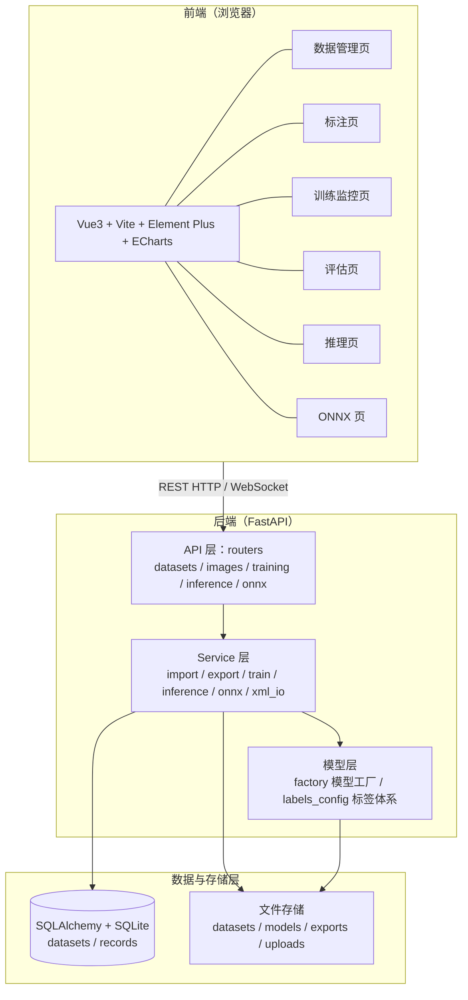
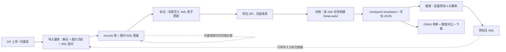
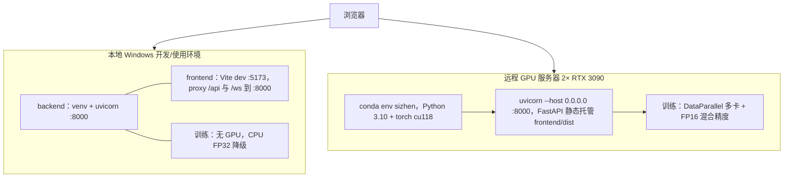

# 四诊数据标注与AI模型训练系统 概要设计说明书

| 项目 | 内容 |
| --- | --- |
| 文档名称 | 四诊数据标注与AI模型训练系统 概要设计说明书 |
| 文档版本 | v1.0 |
| 编写日期 | 2026-09-04 |
| 文档状态 | 设计基线，作为详细设计（T21）与编码的输入 |
| 依据 | 《需求规格说明书》（REQ-6.N-M）、工作规划 Scope 锁定决策 1 至 12、T6 至 T19 任务定义 |

## 1. 引言

### 1.1 编写目的

本文档描述「四诊数据标注与AI模型训练系统」的总体结构与设计思路：系统分层架构、组件模块划分、数据流、关键接口、数据设计、部署拓扑与关键技术决策。本文档只回答「系统怎么组成、各部分组成关系如何」，不涉及函数签名与类级实现细节（由《详细设计说明书》承担）。

### 1.2 设计范围

覆盖需求 6.1 至 6.21 全部 21 条功能需求对应的六大组件：数据管理、图片浏览检索与标注、标注导出、模型训练、批量推理、ONNX 转换。范围边界同需求规格说明书 2.3 节：不做目标检测、不做登录权限、不做多机分布式、不内置真实四诊数据。

### 1.3 术语

沿用《需求规格说明书》1.3 节术语定义（四诊、数据集、内置库、标签体系、标注 XML、预标注、checkpoint、ONNX、宏平均准确率），本文不再重复。

### 1.4 设计依据

- 《需求规格说明书》（docs/需求规格说明书.md）：功能需求 REQ-6.N-M 与非功能需求 NF-7.N。
- 工作规划 Scope 锁定决策 1 至 12：标签语义、XML 真相源、best-model 判据、评估口径、ONNX 阈值、混合训练校验、删除语义、自定义模型边界、GPU 可测性、env-driven 配置、内置库填充、往返保真。
- 项目脚手架（T1）：backend/、frontend/、docs/、data/ 目录结构与依赖清单。

## 2. 总体设计

### 2.1 设计目标

1. 一条端到端链路贯通：导入 → 标注 → 导出 → 训练 → 推理 → ONNX，各环节产物可直接进入下一环节（导出 ZIP 可再导入、预标注 XML 与人工标注同 schema、checkpoint 可被推理与 ONNX 复用）。
2. 本地 Windows 与远程 GPU 服务器双环境同代码运行，差异仅由环境变量与依赖版本决定。
3. 训练在后台执行，标注、浏览、推理不被训练阻塞。
4. 能力边界显式化：凡不保证的能力（自定义模型的 ONNX 转换、第三方权重的结构识别）一律显式报错，不静默降级。

### 2.2 设计原则

| 原则 | 说明 | 依据 |
| --- | --- | --- |
| XML 唯一真相源 | 标签与质量只落在标注 XML；数据库仅镜像 quality 供过滤，杜绝双源漂移 | 决策 2 |
| env-driven 配置 | 数据目录、模型目录、导出目录、DB 路径、标签路径全部经环境变量注入，无硬编码绝对路径 | 决策 10 |
| 前后端分离 | Vue3 前端经 REST + WebSocket 与 FastAPI 后端通信，前端只渲染不计算指标 | 需求 6.12/6.17 |
| 后台训练 | 训练在线程中执行，FastAPI 主线程不被占用，经状态查询与 WebSocket 对外暴露进度 | 需求 6.12 |
| 原子写入 | XML 采用「临时文件 + 替换」原子写，快速连续修改不产生半截文件 | 决策 12 |
| 往返保真 | 导出 ZIP 再导入后，标签与 quality 与原数据逐字节一致 | 决策 12 |

### 2.3 总体架构



## 3. 系统分层架构

系统自顶向下分四层：

| 层 | 组成 | 职责 |
| --- | --- | --- |
| 前端层 | Vue3 + Vite，Element Plus 组件库，ECharts 图表，axios + WebSocket 通信 | 页面交互、数据展示、训练曲线与评估图渲染；不承担任何指标计算 |
| API 层 | FastAPI routers（datasets、images、training、inference、onnx）+ CORS + 静态服务 + 统一异常处理 | 路由、请求参数校验、响应 JSON 契约、WebSocket 端点、静态图片与前端产物服务 |
| Service 层 | import_service、export_service、train_service、inference_service、onnx_service、xml_io 等 | 业务逻辑：导入解析、导出打包、训练调度、批量推理、模型转换、XML 读写 |
| 数据与存储层 | SQLAlchemy ORM + SQLite；文件存储目录 data/datasets、data/models、data/exports、data/uploads | 记录持久化、图片与 XML 落盘、checkpoint 与 ONNX 产物存放 |

分层约束：

- 上层只依赖紧邻下层：API 层不直接触碰 ORM 与文件系统，一律经 Service 层。
- 标签体系由 labels_config 统一解析暴露，标注、训练建码、预标注生成三方共用同一来源。
- 训练在线程中运行，其状态与指标写入线程安全缓冲区，经 API 层对外提供。

## 4. 组件模块划分

### 4.1 六大组件模块表

| # | 模块 | 一句话职责 | 对应需求 |
| --- | --- | --- | --- |
| 1 | 数据管理模块 | 数据集的创建/列表/重命名/删除，ZIP 导入入库，内置库按时间范围与质量过滤拉取 | 6.1、6.2 |
| 2 | 图片浏览检索与标注模块 | 翻页/进度条/搜索浏览图片，标签树标注、快捷键操作、自动保存 XML、硬删除数据 | 6.3、6.4 |
| 3 | 标注导出模块 | 将数据集全部图片与同名 XML 打包为 ZIP 下载，保证导出→再导入往返保真 | 6.5 |
| 4 | 模型训练模块 | 混合数据集训练（ResNet18/50/自定义模型、GPU/CPU/FP16、超参/增强/断点续训、实时监控、混淆矩阵/ROC 评估） | 6.6 至 6.14 |
| 5 | 批量推理模块 | 选定数据集与模型批量预测每图 4 类概率，生成与标注界面兼容的预标注 XML | 6.15 至 6.18 |
| 6 | ONNX 转换模块 | PyTorch 到 ONNX 一键转换、逐头精度对比、一键下载 | 6.19 至 6.21 |

### 4.2 后端模块组织

| 后端模块 | 概要职责 | 所属组件 |
| --- | --- | --- |
| routers/datasets | 数据集 CRUD、ZIP 导入入口、内置库拉取、导出入口 | 1、3 |
| routers/images | 图片列表、图片二进制、文件名搜索、标签读写与删除 | 2 |
| routers/training | 训练启动/停止、状态查询、评估结果、WebSocket 推送 | 4 |
| routers/inference | 批量预测、预标注 XML 生成 | 5 |
| routers/onnx | 转换、精度对比、下载 | 6 |
| services/xml_io | 标注 XML 读写（原子写），标注与预标注共用 | 2、5 |
| services/import_service | ZIP 解压、图片识别、XML 配对、入库汇总 | 1 |
| services/export_service | 数据集 ZIP 打包（流式下载） | 3 |
| services/train_service | 训练线程、DataLoader 构建、断点续训、指标缓冲、评估计算 | 4 |
| services/inference_service | checkpoint 结构识别与载权、批量前向、预标注生成 | 5 |
| services/onnx_service | torch.onnx.export、onnxruntime 对比、报告生成 | 6 |
| models/factory | ResNet18/50 构建（4 头）、自定义模型动态加载 | 4、5、6 |
| config / labels_config | 环境变量配置、标签体系解析 | 全局 |

### 4.3 前端视图组织

| 视图 | 概要职责 | 所属组件 |
| --- | --- | --- |
| DatasetManage | 数据集列表、新建/重命名/删除、下拉选择 | 1 |
| Annotate | 大图浏览、翻页/进度条/搜索、标签树、快捷键、自动保存 | 2 |
| Train | 训练配置表单、启动/停止、实时监控曲线（WS + 轮询降级） | 4 |
| Evaluate | 混淆矩阵热力图与 ROC 曲线渲染（含 AUC） | 4 |
| Infer | 数据集与模型选择、预测结果表格、预标注生成入口 | 5 |
| Onnx | 模型选择、转换、对比报告展示、下载 | 6 |

## 5. 数据流设计

### 5.1 主链路数据流



### 5.2 各环节说明

1. **导入**：ZIP 上传后解压，识别白名单后缀图片（jpg/jpeg/png/bmp/gif），与同名 XML 配对；每张图片落盘到数据目录、写入 records 表（含 timestamp 与 quality 镜像），缺失 XML 的图片跳过并列入错误清单。导入同时填充内置库。
2. **内置库拉取**：按 timestamp 时间范围查询内置库记录，质量过滤默认「只保留合格」，以复制关联方式进入目标数据集，源记录不变。
3. **标注**：浏览页读取 XML 标签展示；标签变更经 debounce 自动保存，XML 原子写入；质量勾选同步写 XML 并镜像到 records.quality。
4. **导出**：遍历数据集全部记录，打包图片与同名 XML 为 ZIP 流式下载；空标签的未标注记录同样导出。
5. **训练**：从主数据集与叠加数据集读取 XML 标签构建训练数据（taxonomy 一致性先校验），后台线程训练，每 epoch 存 best/latest checkpoint，训练结束计算每类混淆矩阵与 one-vs-rest ROC。
6. **推理**：从模型目录加载 checkpoint，按其中记录的结构与类别数重建网络并载权，整集批量前向，输出每图每类预测子标签与概率。
7. **预标注**：用与人工标注相同的 XML writer 生成预标注文件，confidence 写预测概率，输出到独立目录，不覆盖人工标注。
8. **ONNX**：checkpoint 导出为 .onnx，用 onnxruntime 在同一输入上逐头对比输出，max abs diff < 1e-3 判 PASS，报告展示后支持下载。

## 6. 关键接口清单（概要级）

> 本清单为概要级接口分组，完整的方法/入参/出参/错误码表见《详细设计说明书》。

### 6.1 REST 接口

| 分组 | 接口路径 | 方法 | 概要职责 | 需求映射 |
| --- | --- | --- | --- | --- |
| 数据管理 | /api/datasets | POST / GET / PATCH / DELETE | 数据集创建、列表、重命名、删除（重名冲突明确报错） | 6.1 |
| 数据管理 | /api/datasets/pull | POST | 从内置库按时间范围 + 质量过滤拉取记录进目标数据集（复制关联） | 6.2 |
| 数据导入 | /api/datasets/{id}/import | POST（multipart ZIP） | 解压、图片识别、XML 配对、入库，返回进度与汇总（导入数/跳过数/错误列表） | 6.2 |
| 浏览检索 | /api/datasets/{id}/images | GET | 分页/全量图片列表（含 filename） | 6.3 |
| 浏览检索 | /api/datasets/{id}/images/{filename} | GET | 返回图片二进制 | 6.3 |
| 浏览检索 | /api/datasets/{id}/images/search?q= | GET | 文件名模糊搜索 | 6.3 |
| 标注 | /api/datasets/{id}/image/{filename}/labels | GET / PUT | 读取该图标签；写入标签（原子写 XML，自动保存通道） | 6.3、6.4 |
| 标注 | /api/datasets/{id}/image/{filename} | DELETE | 硬删除数据集内记录行与 XML（前端二次确认，源库记录不受影响） | 6.4 |
| 导出 | /api/datasets/{id}/export | GET | 打包图片 + 同名 XML 为 ZIP 流式下载 | 6.5 |
| 训练 | /api/training/start | POST | 接收训练配置（主/叠加数据集、backbone、超参、增强、FP16、断点文件），后台启动训练线程 | 6.6 至 6.11 |
| 训练 | /api/training/status | GET | 查询训练状态与累计指标（轮询兜底通道） | 6.12 |
| 训练 | /api/training/stop | POST | 手动停止训练 | 6.12 |
| 训练 | /api/training/eval/{job} | GET | 返回 4 张混淆矩阵与 4 组 ROC 点列（含 AUC） | 6.13 |
| 训练 | /api/training/models | GET | 本地模型目录与 checkpoint 存档列表（供加载与断点选择） | 6.11、6.14 |
| 推理 | /api/inference/predict | POST | 指定数据集与模型，整集批量前向，返回每图每类预测子标签与概率 | 6.15、6.16、6.17 |
| 推理 | /api/inference/preannotate | POST | 基于预测结果生成预标注 XML（独立输出目录，不覆盖人工标注） | 6.18 |
| 模型转换 | /api/onnx/convert | POST | 选定 checkpoint 导出 .onnx（ResNet18/50 保证，自定义模型失败显式报错） | 6.19 |
| 模型转换 | /api/onnx/compare | POST | 用 onnxruntime 逐头对比 PyTorch 与 ONNX 输出，返回各头 max abs diff 与 PASS/FAIL 报告 | 6.20 |
| 模型转换 | /api/onnx/{name}/download | GET | 下载 .onnx 文件 | 6.21 |
| 系统 | /api/health | GET | 健康检查，返回服务状态 | 非功能 |

### 6.2 WebSocket 接口

| 端点 | 方向 | 概要职责 | 需求映射 |
| --- | --- | --- | --- |
| /ws/training | 服务端 → 客户端 | 训练期间实时推送 epoch、loss、train_acc、val_acc 指标帧 | 6.12 |

前端在 WebSocket 断开时自动降级为 2 秒轮询 /api/training/status，重连成功后恢复推送，保证曲线不中断。

### 6.3 接口通用约定

- 请求与响应统一 JSON；错误统一返回 `{detail: 可读错误信息}`。
- 图片一律经 /api 服务端点获取，前端不直读磁盘二进制。
- CORS 允许本地开发源（如 :5173）与远程访问域名。
- 上传内容做类型与大小校验；路径写入限定在系统管理目录内。

## 7. 数据设计（概要）

### 7.1 数据库

SQLite 单库（data/db.sqlite），SQLAlchemy ORM 访问，共 2 张表（字段定义见需求规格 5.3 节，详细建表见《详细设计》）：

- **datasets**：id、name（唯一）、created_at、updated_at。
- **records**：id、dataset_id（外键）、filename、image_path、timestamp（可空）、quality（可空，镜像 XML）、created_at。

语义要点：标签不落库，唯一真相源在 XML；内置库与数据集共用 records 表；拉取为复制关联，删除为硬删除。

### 7.2 标注文件

每图同名 XML，schema 与样例见 docs/annotation-schema.sample.xml：annotation 根元素含 folder、filename、path、size（width/height/depth）、quality、labels（0 至 4 个 label，每类至多 1 个，label 含 category/name/confidence）。人工标注 confidence = 1.0，预标注 confidence = 预测概率。写入采用原子替换。

### 7.3 文件存储布局

```
data/
├── db.sqlite              # SQLite 库
├── datasets/<数据集>/      # 图片 + 同名 XML（含内置库对应记录）
├── models/                # checkpoint（best/latest）与 .onnx 产物
├── exports/               # 导出 ZIP 产物
└── uploads/               # ZIP 上传临时解压区
```

所有目录路径经环境变量（DATA_DIR / MODEL_DIR / EXPORT_DIR / UPLOAD_DIR / DB_URL / LABELS_PATH）注入。

## 8. 部署拓扑

### 8.1 部署形态



### 8.2 本地 Windows 部署（开发/CPU 使用）

- 后端：创建 venv，安装 requirements.txt，`uvicorn app.main:app --port 8000`。
- 前端：`npm install` 后 `npm run dev`，Vite 配置代理将 /api 与 /ws 转发至后端 :8000，规避跨域。
- 训练默认 CPU 降级（FP32），功能完整可演示。

### 8.3 远程 GPU 服务器部署

- 用 conda 新建独立环境 sizhen（Python 3.10 + torch cu118），不复用服务器上其它项目环境。
- 后端安装依赖后以 `uvicorn --host 0.0.0.0 --port 8000` 启动，监听外部访问。
- 前端 `npm run build` 产出 dist，由 FastAPI 静态托管，单端口交付，无需 Nginx。
- 训练启用 DataParallel 多卡与 FP16；进程守护方式（systemd 等）在部署文档中细化。
- 具体服务器地址、端口与完整命令见《部署文档》（T24）与 GPU 冒烟清单（T25）。

### 8.4 双环境一致性

同一套代码同时满足两种环境，差异仅存在于环境变量与依赖版本：全部路径、DB、标签配置经 config.py 读环境变量注入；GPU 数量由运行时自动检测（0 卡 CPU、1 卡单卡、多卡 DataParallel），无 GPU 环境自然降级，无需改代码。

## 9. 关键技术决策

### 9.1 核心决策速览（逐条一句话）

1. **4 头多分类模型**：模型输出 4 个并行分类头（舌/面/脉/声音），每头对各自子标签做 softmax 多分类、独立输出预测子标签与概率，loss 在 4 头上求和（CrossEntropy 默认、FocalLoss 备选），直接匹配「各类别预测值」的需求语义（决策 1）。
2. **XML 唯一真相源**：标签与质量只落在标注 XML，数据库仅镜像 quality 供 6.2 快速过滤，标注写入、预标注生成、训练建码三方共用同一 schema，杜绝双源漂移（决策 2）。
3. **SQLite**：单机单用户、数据量小、零运维，文件即库便于备份迁移，2 张表满足全部持久化需求，不引入 Postgres/Redis 等超范围组件。
4. **DataParallel / FP16**：多卡用 DataParallel（仅对 ResNet18/50 保证）、GPU 上支持 FP16 混合精度（AMP + GradScaler），无 GPU 时自动降级 CPU FP32，保证本地与服务器同代码可用（决策 8、9）。
5. **WebSocket 实时监控**：训练指标经 /ws/training 每轮推送，断线自动降级 2 秒轮询 /api/training/status，兼顾实时性与弱网可靠性（决策 4）。
6. **ONNX 1e-3 精度阈值**：转换后逐头计算 PyTorch 与 ONNX 输出的 max abs diff，< 1e-3 判 PASS，阈值容纳 FP16 精度差异（决策 5）。

### 9.2 锁定决策一览表

| 决策 | 设计落地要点 |
| --- | --- |
| 1 标签语义 | 多任务多分类，每类第一项固定为「正常/无」默认类 |
| 2 XML schema | 含 quality 字段；标注与预标注共用同一读写实现 |
| 3 best-model 判据 | 4 头 macro-average val_acc 算术均值最大；每 epoch 存 best + latest；断点恢复 best-so-far 追踪器 |
| 4 ROC/混淆矩阵 | 每类一张混淆矩阵 + 一对一 ROC；全程保留概率，不只用硬标签 |
| 5 ONNX 阈值 | 每头 max abs diff < 1e-3 判 PASS |
| 6 混合训练 | 训练前校验全部数据集 taxonomy 一致，不一致硬失败报错 |
| 7 删除语义 | 硬删除数据集内记录行 + XML；内置库不可变，无软删除标记 |
| 8 自定义模型 | ONNX 转换与结构读取仅保证 ResNet18/50；自定义模型 best-effort + 显式失败提示 |
| 9 GPU 可测性 | 本地 CPU 降级路径用单测覆盖；多卡/FP16 真实路径用服务器冒烟覆盖 |
| 10 env-driven | 配置全部经环境变量注入，双环境同代码 |
| 11 内置库 | ZIP 导入即入库；拉取为复制关联，不物理移动 |
| 12 往返保真 | XML 原子写（临时文件 + rename）；导出→再导入逐字节一致 |

## 10. 非功能设计考虑

| 类别 | 设计机制 | 需求映射 |
| --- | --- | --- |
| 性能 | 图片经 /api 流式返回；标注切换目标 < 200ms；ZIP 导入返回进度与汇总；训练在后台线程，不阻塞其它操作 | NF-7.1 |
| 易用性 | 快捷键全覆盖（←/→、1 至 4、S、Q）；破坏性操作二次确认；当前位置 n/m 与进度提示 | NF-7.2 |
| 健壮性 | 损坏 ZIP/缺 XML/非法标签分类报错；原子写防半截文件；断点续训；无 GPU 自动降级 | NF-7.3 |
| 安全性 | 上传类型与大小校验；路径写入限定系统目录；自定义模型执行风险显式声明 | NF-7.4 |
| 可维护性 | 分层组织、配置集中、XML 单一真相源、核心模块自动化测试覆盖 | NF-7.5 |

## 11. 约束与遗留风险

- **GPU 真实验证风险**：本地无 GPU，多卡 DataParallel 与 FP16 的真实路径以服务器冒烟测试兜底（GPU_SMOKE 清单），本地仅验证 CPU 降级路径。
- **自定义模型执行风险**：自定义模型代码在本机 Python 进程内加载执行，系统明确声明该风险，不做沙箱隔离。
- **标签占位**：子标签为占位默认值，用户按真实四诊标签修改 labels.yaml 后全链路自动生效。
- **分类语义假设**：按「4 头并列多分类」实现；若实际需「一张图只归四类之一」或「每类多选」，需回退修改需求基线（C-6）。
